## Способы отсечения света

### Light Volume

Рисуется геометрия в форме освещенной области, обычно это сфера и конус. Результат суммируется за счет блендинга.
Тест глубины позволяет отсечь невидимые области.

У этого подхода много недостатков:
* Обрабатывается вся область за отрисованым объемом, даже если расстояние слишком большое. Тест глубины в FS не решает проблему так как нужно чтобы завершились все потоки варпа.
* Quad overdraw - на границах треугольников создаются дополнительные потоки.
* В один варп могут попасть треугольники соседних светильников, поэтому все данные для расчета освещения хранятся в векторных регистрах и при превышении лимита на регистры производительность уменьшается.
* Смешивание в fp16 формате не очень быстрое на некоторых ГП, а использовать R11G11B10F формат не получится из-за низкой точности при накоплении.
* Каждый источник света будет читать GBuffer, но на тайловом рендере все останется в кэше.
* Меньше всего использует регистры, что особенно важно для мобилок, где их мало. Превышение лимита (32 для Mali) регистров приводит к двухкартному уменьшению потоков.
* Не работает для полупрозрачных объектов и частиц.

Из не самых старых игр такой подход использовался в Fallout 4.

На современных дискретных картах это все равно работает очень быстро, даже несмотря на множественное наложение.
Иногда для оптимизации делают предварительное отсечение по HiZ.

Хороший пример недостатков классического подхода - улица с фонарями. Освещенная область около 30% для каждого источника, остальное это простаивающие потоки.

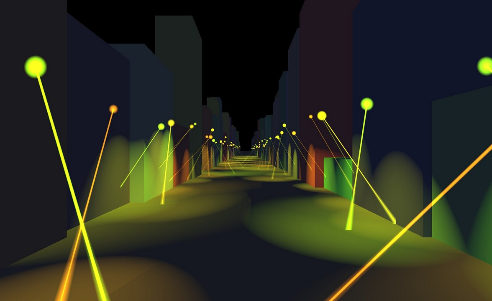

А по центру наложение максимальное, в данном примере доходит до 45 фрагментов на пиксель.

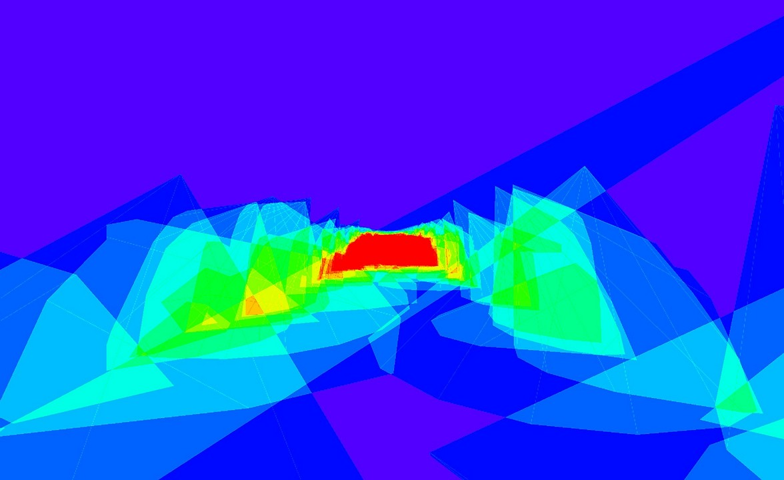

Исходники:
* [Classic deferred](https://github.com/azhirnov/AsEn-ShaderEditor/blob/main/src/scripts/light-cull/ClassicDeferred.as)


### Billboard

Освещенная область проецируется на экран и рисуется прямоугольник.<br/>
Недостатки такие же как у рисования геометрии, только меньше нагружает VS и растеризатор, но занимает больше пикселей из-за чего работает медленее, особенно в 4К.<br/>
Главное преимущество - меньше quad overdraw, что хорошо для рисования небольших областей, например дальних светильников (distant lights) и декоративного освещения.
Также не требует предвариательного отсечения, так как используется всего 4 вызова VS.

Для оптимизации quad overdraw есть вариант использовать point sprites или расширение `VK_NV_fill_rectangle`.

Здесь доходит до 72 фрагментов на пиксель.

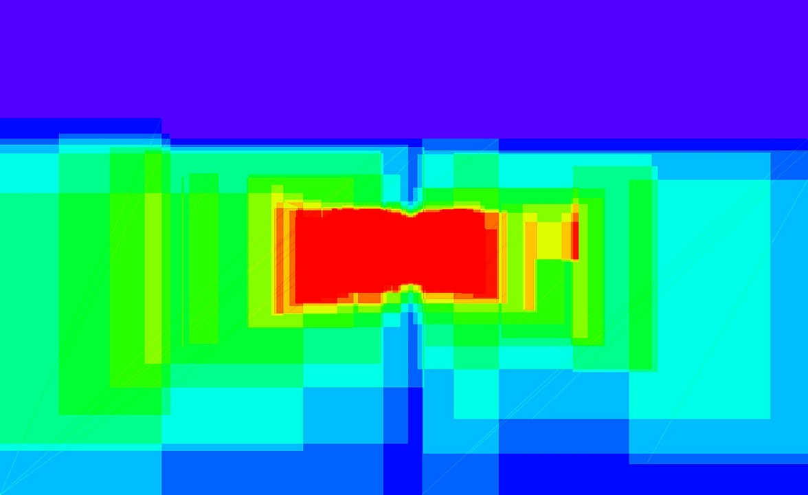

Исходники:
* [Classic deferred](https://github.com/azhirnov/AsEn-ShaderEditor/blob/main/src/scripts/light-cull/ClassicDeferred.as).


### Tiled

Экран разбивается на тайлы.
Для каждого тайла формируется список источников света, чья освещаемая область попадает в тайл.

Для лучшего отсечения используют depth pre-pass и рассчитывают min/max глубины в тайле, тогда если свет не освещает никакую геометрию, то и не добавляется в список.
Но возникает проблема с depth discontinuities - когда в тайл попадает геометрия вблизи камеры и вдали, в результате отсечение по глубине становится менее эффективным.

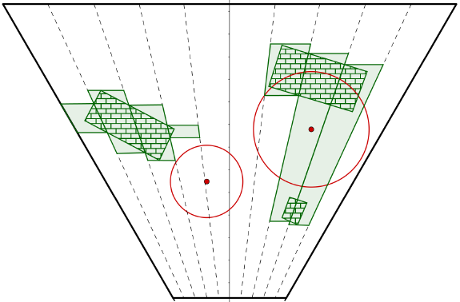

Также оптимизация с DPP не позволяет подсвечивать полупрозрачные объекты сцены, в таких случаях делают оба варианта: оптимизированный с DPP для непрозрачной геометрии и не оптимизированый, возможно с меньшим количеством светильников, для полупрозрачной геометрии и частиц.

Из плюсов GBuffer читается один раз на пиксель тайла, в отличие от кластерного подхода.
В целом чисто тайловый подход устарел и не дает существенного ускорения.

В худшем случае получается 66 светильников на тайл и 8500 всего.

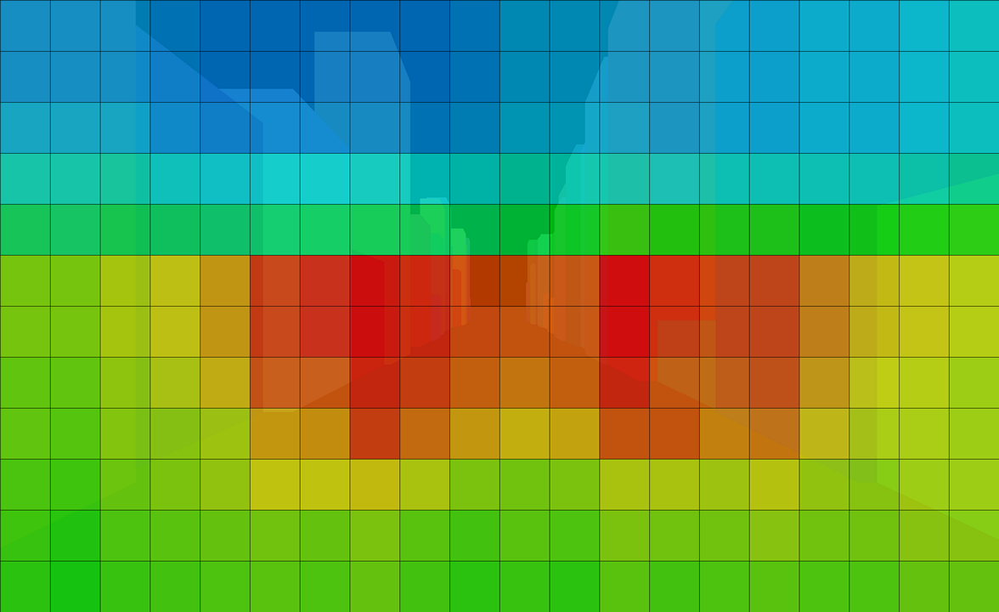

С отсечением по глубине результат лучше - 59 на тайл и 4500 всего.

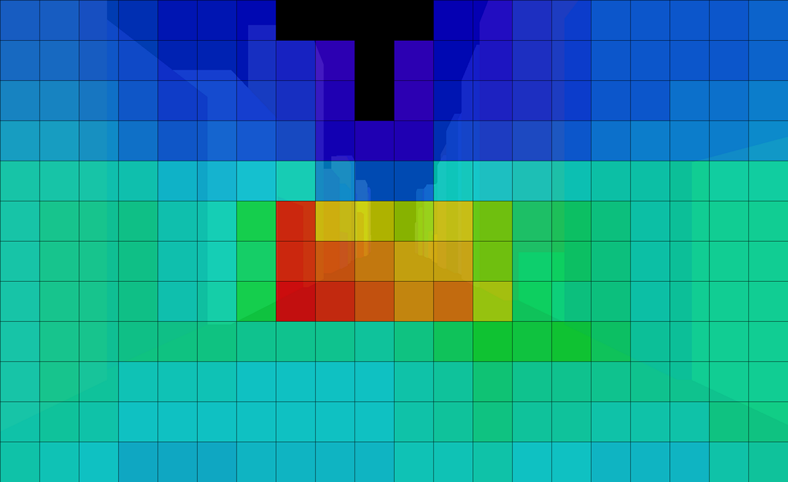

Ссылки:
* [Optimizing tile-based light culling](https://turanszkij.wpcomstaging.com/2018/01/optimizing-tile-based-light-culling/) - способ српавиться с depth discontinuities.
* [Forward vs Deferred vs Forward+](https://www.3dgep.com/forward-plus/#light-culling), [video](https://youtu.be/2Zo3UOUiTxo)
* [Improve Tile-based Light Culling with Spherical-sliced Cone](https://lxjk.github.io/2018/03/25/Improve-Tile-based-Light-Culling-with-Spherical-sliced-Cone.html)

Исходники:
* [Project light volume to tile](https://github.com/azhirnov/AsEn-ShaderEditor/blob/main/src/scripts/light-cull/test-LightVolToTile.as)
* [Tiled Deferred](https://github.com/azhirnov/AsEn-ShaderEditor/blob/main/src/scripts/light-cull/TiledDeferred.as)


### Clustered

Экран также разбивается на тайлы, а затем нарезается по Z.
Обычно используют 16-64 Z слоев, так кластеры получаются более квадратные.

В [Avalanche engine](https://www.humus.name/Articles/PracticalClusteredShading.pdf) использовали 16 слоев и вручную настроеные Z координаты.
Так максимальная дальность кластеров 500м, дальше используются только distant lights, light bulbs.
Ближний кластер растянут по Z на 0.1 - 0.5м, это ухудшает точность отсечения, зато значительно уменьшает количество слоев.

Размеры кластера в играх:
* [Detroit: Become Human](https://www.gdcvault.com/play/1025420/Cluster-Forward-Rendering-and-Anti) - 2 уровня иерархии: 36х20х64 и 18х10х32.
* [Avalanche engine](https://www.humus.name/Articles/PracticalClusteredShading.pdf) - 64x64 pix, 16 slices
* [CoD Infinite Warfare](https://advances.realtimerendering.com/s2017/2017_Sig_Improved_Culling_final.pdf) - 60х32х18 (?)
* [Doom2016 (idTech6)](https://advances.realtimerendering.com/s2016/Siggraph2016_idTech6.pdf) - 16x8x24

Плюсы:
* Не требует depth pre-pass, что хрошо для мобилок.
* Подходит для освещения полупрозрачных объектов и частиц.
* В forward+ режиме не требует чтения из GBuffer.

Минусы:
* Чем больше количество кластеров, тем лучше отсечение, но дороже рассчеты и расходуется больше памяти.
* Есть худшие случаи, когда малая часть объема попадает в кластер или из-за неточности проверки пересечения. Но такие случаи хорошо сглаживаются за счет однородности выполнения (uniform control flow), что позволяет пропустить светильник для всего варпа, если все потоки не прошли тест на расстояние.
* В deferred режиме, где нужно пройтись по многим кластерам получается дублирование светильников из соседних кластеров и пересвеченная картинка в этих местах.
* Как и тайловый плохо подходит для мелких освещенных объемов, например декоративного освещения.

Максимум - 44 светильника на кластер и 48 на пиксель, синий цвет - около 6, голубой - до 13, зеленый - до 30.
Размер кластера - 16х8х24.
Неровные края и более яркие полосы это результат скаляризации, когда битовые маски внутри варпа объединяются.

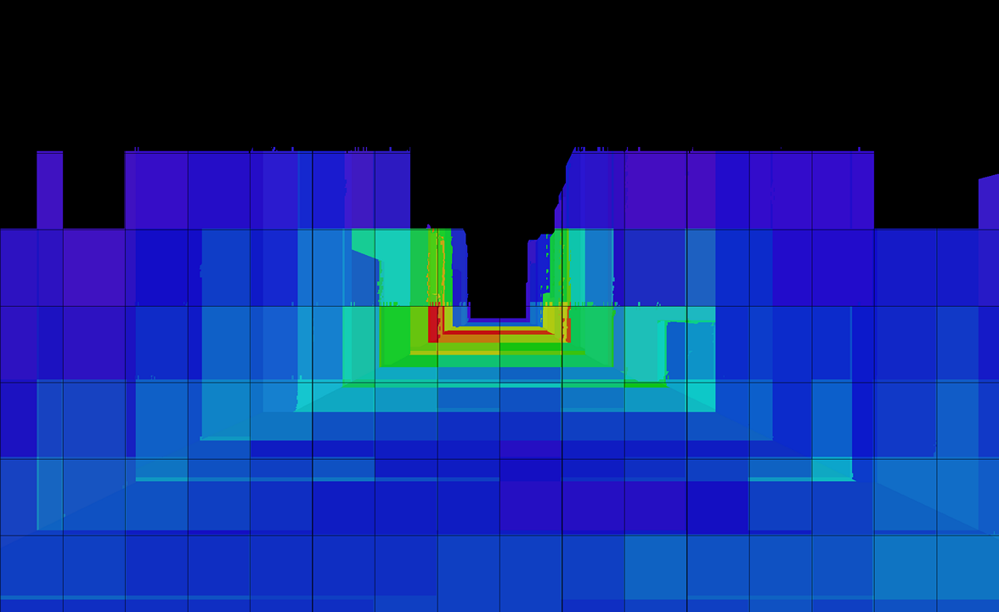

Исходники:
* [Project light volume to cluster](https://github.com/azhirnov/AsEn-ShaderEditor/blob/main/src/scripts/light-cull/test-LightVolToClusters.as)
* [Cluster bounding sphere](https://github.com/azhirnov/AsEn-ShaderEditor/blob/main/src/scripts/light-cull/test-ClusterBoundingSphere.as)
* [Cluster Forward](https://github.com/azhirnov/AsEn-ShaderEditor/blob/main/src/scripts/light-cull/ClusterForward.as)


### Tiled + ZBin

Способ описан в презентации [Improved Culling for Tiled and Clustered Rendering in Call of Duty Infinite Warfare](https://advances.realtimerendering.com/s2017/2017_Sig_Improved_Culling_final.pdf) на слайдах 20-40.
Экран разбивается на тайлы 240х135, светильники сортируются по Z и разбиваются на группы (zbin).
Для каждой группы используется битовая маска с индексам активных источников света в тайле.

При освещении для каждого пикселя по его глубине выбирается zbin и идет обход всех светильников из битовой маски.

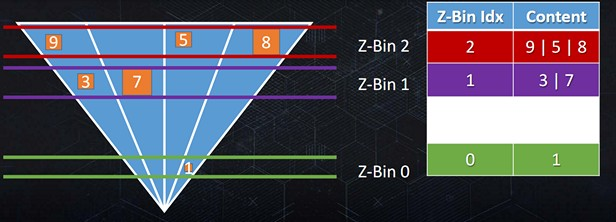

Преимущества такие же как у кластеров, но разрешение намного больше, а памяти расходуется меньше.
Битовые маски решают проблему дублирования светильников в кластерах (ZBin'ах).

Главный недостаток - фиксированный размер битовой маски, если все светильники не влезают, то остаток рисуется другим способом, чаще всего геометрией.
Также дальние светильники рисуются другим способом и более простым шейдером.


## Deferred vs Forward+

### Forward+

Оригинальный forward подход получает список ближайших светильников для каждого объекта сцены, это увеличивает нагрузку на ЦП, так как нужно найти эти светильники для каждого объекта, а желательно еще отсортировать и выкинуть те, что дают наименьший вклад, если их слишком много.
В forward+ предполагается, что светильники расположены в некоторой структуре, привязаной к экрану, поэтому больше не нужно проходить по всем объектам.
С forward+ совместимы только тайловые и кластерные методы разбиения, классический deferred применим с ограничениями.

В презентации по [CoD Infinite Warfare](https://advances.realtimerendering.com/s2017/2017_Sig_Improved_Culling_final.pdf)
на слайде 7 разбирают случай, когда треугольник попадает на несколько тайлов со списком светильников.

На современных NV, ARM Mali, Apple используются тайлы 16х16 - 64х64 и такой проблемы не возникает.

Судя по тестам на [AMD](https://github.com/azhirnov/AsEn-ShaderEditor/blob/main/papers/bench-gpu/AMD_780M.md#Wavefront-scheduler) и [Intel](https://github.com/azhirnov/AsEn-ShaderEditor/blob/main/papers/bench-gpu/Intel_Arc140T.md#Tile-size) в один варп попадают пиксели на расстоянии до 142 (AMD) и 48 (Intel) друг от друга, что в тайловом/кластерном подходе приведет к вырождению потоков и потере производительности.
Аналогично на Adreno, где размер тайла доходит до 512х512, а на новых 840/X2 даже до 1600х1600.
В таком случае только отложенное освещение позволяет избавиться от вырождения потоков.

С другой стороны выход за пределы тайла это редкость и на общую производительность влияет процент худших случаев, который зависит от формы геометрии и ракурса камеры.
А при хранении списка светильников на тайл/кластер в битовых масках производительность улучшается за счет скаляризации.
Потери происходят только если объединяются дальние кластеры с разными светильниками.

При большой вариативности материалов forward подход приводит к низкой нагружености варпов, так как меньше пикселей с одинаковым шейдером могут объединиться в один варп.
Из-за этого сильно снижается производительность на встройках и мобилках, где обычно мало ядер, значит меньше варпов.
Еще есть потери на quad overdraw, особенно на микротреугольниках.

Кроме этого есть еще нагрузка на регистры, так как в одном шейдере происходит и текстурирование и освещение.
С одной строны кажется что все одинаково: обрабатываются материалы, затем выполняется освещение с только нужными регистрами, но часто значения менее сжатые (float, вместо half), либо данных намного больше чем в GBuffer, что требуется для сложных материалов.
Большинство ГП, кроме совсем новых RDNA 4, выделяют регистры под наихудший случай, из-за чего на материалы может уйти больше регистров, чем на освещение, что приведет к потере производительности на втором этапе.
Либо наоборот, первый этап с материалами будет медленее из-за большего расхода регистров на второй этап с освещением.

Преимущество:
* Материал применяется в одном большом шейдере, это удобно, не требуется паковать все в G-буфер, не нужны этапы классификации G-буфера и тд.
* Во времена до TAA и DLSS/FSR forward+ подход позволял использовать MSAA, особенно на мобилках, где это почти бесплатно.
* Без новых расширений типа device generated command или work lists хуже работает с GPU-Driven.
* В forward+ достаточно данных чтобы отрисовать дальние светильники через классический deferred с упрощенным материалом.

Недостатки:
* Для оптимизации требует depth pre-pass или earlyZ с сортировкой от камеры.
* Остается G-буфер для постпроцессов, подробнее про минусы написано в минусах deferred подхода.
* Больше нагрузка на регистры, что при выходе за лимиты приводит к двухкратному уменьшению параллельно выполняющихся потоков.
* Меньшее заполнение варпа (occupancy) из-за разных шейдеров.
* В худшем случае в варп попадает 4 и более тайла/кластера, что снижает производительность.
* Нет возможности оптимизировать мелкие и слишком большие светильники, только дальние.
  Мелкие декоративные светильники все еще можно отрисовать как и дальние, но только с упрощенным материалом.


### Deferred

Кроме классического отложенного освещения сюда относится и отложенное текстурирование и Visibility buffer, последние два никак нельзя перевести на Forward+.

С отложенным освещением совместимы все методы отсечения светильников, разница только в производительности.

Преимущество:
* Для мобилок это более простые шейдеры, а значит лучше производительность на каждом этапе.
* За счет меньшей вариативности шейдеров на этапе заполнения G-буфер он лучше подходит под GPU-Driven.
* Позволяет комбинировать разные варианты списков светильников для наилучшей производительности.
* Лучше однородность выполнения в пределах варпа при обходе списка светильников, а применение освещения как раз одна из дорогих операций.
  Даже нетайловые ГП для полноэкранного прохода распределяют потоки и варпы компактно в тайлы 4х2 - 8х8 ([примеры тут](https://github.com/azhirnov/AsEn-ShaderEditor/blob/main/papers/GPU_Benchmarks.md#Subgroup-threads-order)).
  Достаточно выровнять размер тайла/кластера к границе варпа при полноэкранном прохде, либо к размеру тайла на NV, Mali, Apple.

Недостатки:
* Обычный G-буффер слишком "толстый" и встроеные ГП начинают упираться в пропускную способность памяти, но это не затрагивает мобильные TBDR, где доступно 128бит/пиксель без потери производительности (Mali, Apple).
  На Adreno размер тайла зависит от размера G-буфера, чем больше бит на пиксель, тем больше тайлов будет на экране.
* На упаковке данных в G-буфер теряется точность, что немного ухудшает качество финальной картинки.
* Для сложных материалов нужно больше данных, что раздувает G-буфер.
* Применение разных материалов требует либо ветвление в шейдере, либо этапа классификации, оба варианта не оптимальны на всем железе и требуется искать более быстрый под каждый ГП.
  Для TBDR работает material depth buffer, но есть потери на quad overdraw, а по тестам на Adreno 600 оптимизация не работает.
  Для дискретных карт лучше классификация в компьют шейдере, но только на AMD RDNA поддерживается компрессия при записи в текстуру из компьют шейдера, и даже там нужны блоки 4х4.
  Ветвление быстрое пока все потоки варпа идут по одному пути, если вариантом материалов не много, то это хороший вариант для всех ГП.
* Больше разброс по Z в пределах варпа (depth discontinuities), из-за этого кластерный и ZBin подход деградирует до неоптимизированного тайлового.
  Решается классификацией, те же проблемы перечислены в предыдущем пункте.
  Но так можно использовать тот-же список светильников и для прозрачных объектов, которые рисуются в forward режиме.
  На NV Turing+ есть оптимизация для вырожденых случаев - independent thread scheduling, что в теории должно бысть эффективнее классификации.


### Итог

Наиболее удачные сочетания:
* Clustered Forward
* Tiled (+ZBin) Deferred
* Tiled ZBin Forward
* Clustered Deferred + Classification, Translucent pass (Clustered Forward) - сложнее в реализации


## Варианты заполнения списка источников света

Первым этапом идет отсечение светильников, которые не пересекаются с фрустумом камеры, это уменьшает размер списка и ускоряет проверки.
Желательно еще отсортировать их по расстоянию до камеры, это позволит отбрасывать светильники не уместившиеся в фиксированый массив.

Еще важный этап - убрать слишком мелкие светильники, если они занимают малую часть тайла/кластера, то эффективнее использовать классический deferred, но для forward+ это не применимо.
Также убираются и слишком большие светильники, эффективнее заменить их полноэкранным проходом или также геометрией, что даст лучшее отсечение неиспользуемых пикселей.


### 1 вариант

Один поток компьют шейдера соответствует тайлу/кластеру и проверяет видимость каждого источника света.

Псевдокод:
```cpp
// thread == tile
for (light in LightList)
	IntersectTileWithLight()
```

Для тайлового подхода, где не так много потоков это неплохой вариант:
* Сохраняется когерентность потоков.
* Последовательное чтение всех источников света хорошо кэшируется и префетчится.
* Можно сохранять индексы источников света в локальную память и затем записать в линейную память для более быстрого чтения.
* Нет атомарных операций.

Из минусов:
* Повышенная нагрузка на ALU, но современные ГП с этим хорошо справляются.
* Кэширование перестает работать, когда варпов слишком много и они запускаются, когда другие закончат работу. Получается чтение всех источников начинается заново.
  На мобилках с небольшим количеством ядер это частый сценарий.

Такой подход используют в [Filament](https://google.github.io/filament/Filament.md.html#annex/lightassignmentwithfroxels), только запускают по несколько потоков на фроксель, чтобы лучше распараллелить.

Также делают в [Detroit: Become Human](https://www.gdcvault.com/play/1025420/Cluster-Forward-Rendering-and-Anti), но в 3 прохода в async compute.
1й проход считает количество светильников в кластере, 2й - расчитывает индекс первого светильника, 3й - записывает индексы в кластер.

Хорошо оптимизируется с помощью операций над сабгруппами, когда один варп обрабатывает один тайл/кластер.
Это уменьшает количество итераций цикла и использует больше потоков, что лучше параллелится на больших ГП.
Для большого количества светильников (16К+) такой способ дает ускорение в 1000 раз.

На старых ГП без операций над сабгруппами есть вариант с атомарными оперциями над общей памятью, это стоит в 20-30 тактов минимум, против 2-3 при использовании сабгрупп.


### 2 вариант

Запустить по одному потоку компьют шейдера на каждый источник света и спроецировать его на тайлы или кластеры.

Псевдокод:
```cpp
// thread == light
tile_aabb = LightToTiles();

for (y : tile_aabb)
for (x : tile_aabb)
{
	IntersectTileWithLight()
}
```

* Потоки вырождаются - каждый обрабатывает свои данные и обходит разное количество тайлов. В результате время выполнения всего варпа зависит от времени самого медленного.
* Хороший вариант для большого количества мелких источников света, тогда вырождение не оказывает существенного влияния, а работа хорошо параллелится.
* Используется атомарная операция чтобы увеличить счетчик светильников в тайле/кластере. Либо чтобы добавить бит, что быстрее, так как варп не ждет результат атомарной операции.

Этот вариант еще лучше оптимизируется с помощью сабгруп.
Почти все ветвления однородны в пределах варпа, что позволяет завершать варп целиком вместо вырождения потоков одного варпа.
Изначальный подход и так быстрый, а с оптимизацией становится в 1.5-2 раза быстрее.

* Лучше сохраняется когерентность потоков.
* Работа хорошо параллелится и меньше варпов простаивает. Что не актуально для слабых мобилок.
* Для мелких источников света не все потоки варпа будут активны, что плохо для мобилок, где намного меньше активных варпов.
* Больше атомарных операций, так как больше потоков. Что тоже плохо для мобилок.

В итоге этот вариант хорош для тайловой техники, где нужно обойти больше светильников.
Для кластеров, где больше ячеек, но в них меньше светильников, этота оптимизация чаще приводит к неполностью нагруженым варпам и потере производительности.
Особено плохо может быть на Adreno и PowerVR, где до 128 потоков на варп.


### 3 вариант

Используя консервативную растеризацию спроецировать освещенный объем на тайлы или кластеры.

В презентации по [CoD Infinite Warfare](https://advances.realtimerendering.com/s2017/2017_Sig_Improved_Culling_final.pdf) на слайдах 41-49 разбирается подход с консервативной растеризацией.
Каждый прошедший пиксель через AtomicOr записывает индекс светильника в битовое поле тайла, тут каждый пиксель рендер таргета соответствует целому тайлу.

Такой подход чаще используется для сложной геометрии, которую труднее просчитать аналитически.
Например, в Infinite Warfare используют прокси геометрию, чтобы ограничить область света, тогда светильник вблизи занимает меньше тайлов.

[Пример](https://github.com/azhirnov/AsEn-ShaderEditor/blob/main/src/scripts/tests/ConservativeRaster.as) с разными способами эмуляции консервативной растеризации.

<details><summary>Нюансы оптимизации</summary>

*Старое железо содержит оптимизации всего для нескольких атомиков, превышение этого количество может быть сильно дороже, но если результат атомарной операции не используется, то выполнение варпа не остановится и все будет достаточно быстро.*

*Стоит помнить, что многие ГП не выполняют рендер пассы параллельно, поэтому рисование низкополигональной геометрии в низком разрешении приводит к простою большинства вычислительных блоков (CU).
В Infinite Warfare предлагают добавить async compute, чтобы нагрузить простаивающие CU.*

</details>


### 4 вариант

Варианты 1 и 2 изначально были на ЦП. Оптимизация тайлового подхода, где читается буфер глубины сложнее перенести на ЦП, хотя и там есть софтварная растеризация для отсечения невидимых бъектов.

В [idTech6](https://advances.realtimerendering.com/s2016/Siggraph2016_idTech6.pdf) (слайды 5-6) заполнение списка светильников идет на ЦП, задача параллелится между ядрами: "1 job per depth slice" и используется SIMD.
Но сейчас ГП намного быстрее справляются с этой задачей и выделяют меньше тепла, поэтому подход устарел.

В блог-посте [Clustered shading evolution in Granite](https://themaister.net/blog/2020/01/10/clustered-shading-evolution-in-granite/) предлагается софтварная растеризация на ГП, что является хорошей заменой консервативной растеризации и при этом может выполняться на компьют шейдере не блокируя все вычислительные блоки ГП.


### Список или битовая маска

Есть несколько вариантов хранения списка светильников:
* Фиксированный массив под каждый тайл.
* Глобальный массив и диапазон в нем для каждого тайла.
* Фиксированный массив битовых масок под каждый тайл.
* Диапазон битовых масок, используется в TileZBin подходе.

Только битовые маски гарантированно не переполнятся в самом худшем случае, при этом в среднем лучше экономят место, а также лучше скаляризуются при обходе списка светильников. Не требуют двойного теста видимости и сразу сортируют светильники для более последовательного доступа к памяти.

Другие варианты не так уж плохи, в 32 битные индексы часто упаковывают дополнительную информацию типа индекса декали.
А расширения позволяют использовать 16 битные индексы.

Глобальный массив требует первый проход с подсчетом количества светильников, а во втором только идет заполнение списка, что дороже.

На 4К светильников получаем 512 байт (128х32бита) на тайл для битовых масок, для больших тайлов/кластеров это приемлимо, но для слишком мелких получается большой расход памяти.
Более реальные сценарии, где 64-256 светильников, тогда битовые маски выигрывают.
Переход на диапазон битовых масок дает еще больший выигрышь по памяти, но требует сортировку по глубине.


## Точность аналитического метода

### Сфера

Точесный источник света создает освещенный объем в форме сферы.

Есть несколько вариантов проверки видимости сферы.

**Проверка попадания в фрустум**

Для каждого тайла или кластера расчитывается фрустум (призма, параллелепипед).
Далее проверяется дистанция до каждой плоскости фрустума.

У этого метода бывают ложные срабатывания, когда сфера оказывается между вертикальными и горизонтальными плоскостями, но не внутри объема.

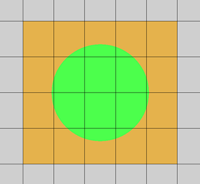

В тайловом подходе проблема решается отсечением по расстоянию до оси Z фрустума.
В кластерном подходе дешевле использовать проверку пересечения сферы с ограничивающей сферой кластера.

В презентации [Practical Clustered Shading](https://www.humus.name/Articles/PracticalClusteredShading.pdf) на слайде 33-35 предлагают другой способ с проверкой расстояния до X и Y плоскостей.
Результат такой же, но вычислений должно быть поменьше.

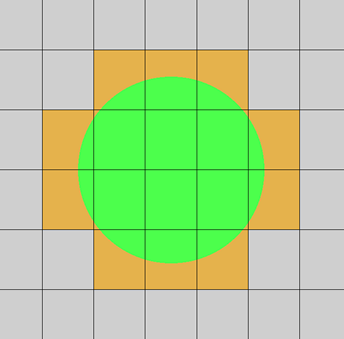


**Проекция сферы на экран**

Более быстрый метод. Сфера проецируется на экран, затем для нее расчитываются затронутые тайлы.
Из-за перспективного искажения сфера проецируется в виде эллипса.

Здесь точно такие же ложные срабатывания по углам, но проверка более дешевая в 2D пространстве.


### Конус

Направленный источник света создает освещенный объем в форме конуса.

**Проверка попадания в фрустум**

Детально разобрано в статье [Cull that cone! Improved cone/spotlight visibility tests for tiled and clustered lighting](https://bartwronski.com/2017/04/13/cull-that-cone/).

Какие есть варианты:
* Проверка по ограничивающей сфере. Тут чем больше угол, тем хуже точность.
* Проверка по вершине и ограничивающей сфере основания конуса. Аналогично, чем больше угол, тем больше радиус основания.
Пример [Frustum2D](https://github.com/azhirnov/AsEn-ShaderEditor/blob/main/src/scripts/tests/Frustum2D-2.as).


Столько получается ложных срабатываний для проверки по фрустуму.

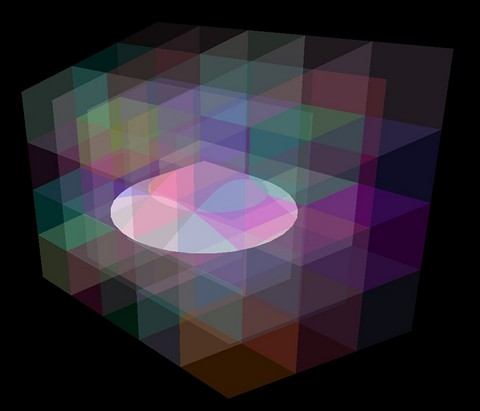

Другой способ - рассчитать расстояние от конуса до центра кластера и сравнить с радиусом ограничивающей сферы.
Используется SDF функция [от iquilezles](https://iquilezles.org/articles/distfunctions/), либо более быстрая, но менее точная формула из [Cull that cone](https://bartwronski.com/2017/04/13/cull-that-cone/).

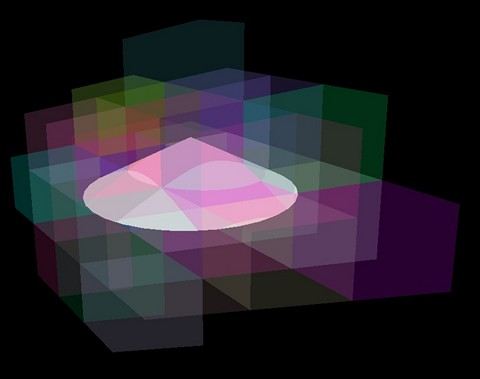

Но из-за формы кластера ограничивающая сфера слишком большая и ложных срабатываний все еще много.
Оптимальней должен быть более точный тест по фрустуму, AABB или OOBB.

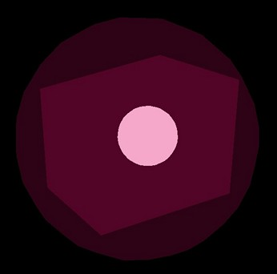


## Разбиение по глубине

Важно для кластерного метода, так как в зависимости от формы кластера меняется точность проверки попадания освещенного объема в кластер.

Чем ближе форма кластера к кубу, тем точнее метод проверки пересечения с ограничивающими сферами.
Но когда форма кластера более вытянутая, требуется более точная проверка на пересечение с AABB или пирамидой.

С другой стороны, чем больше кластеров, тем больше расход памяти, а значит сильнее загрязняется кэш.

Различные варианты разбиения по Z есть в [примере](https://github.com/azhirnov/AsEn-ShaderEditor/blob/main/src/scripts/light-cull/test-ClusterBoundingSphere.as).


## Хранение списка светильников

### 1 вариант

Для каждого тайла/кластера копировать данные светильников в отдельный список.
Копирование дешевое и места занимает не много, зато при обходе списка данные хранятся локально.

В худшем случае данные светильников продублируются во многих тайлах/кластерах.

В результате первое обращение к списку загрузит данные из глобальной памяти в кэш, затем быстро пробегает по светильникам.
Это имеет смысл только для очень больших списков или очень маленьких кэшей, в который невозможно уместить один глобальный список светильников.


### 2 вариант

Для каждого тайла хранится битовая маска или минимальный и максимальный индекс светильников.
Так как индекс первого светильника заранее неизвестен, то варп остановится в ожидании пока прочитаются данные.
За счет того, что список светильников один на все тайлы, эти данные попадают в кэш и последующий доступ будет быстрее.

Тут важно чтобы все светильники уместились в кэш, что не сложно даже на слабом железе.

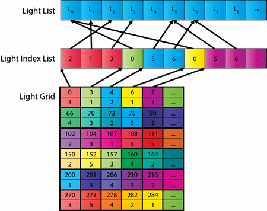


## Итог

Идеального варианта нет и нужно подбирать технику под сцену, а дальше оптимизировать и технику и сцены.

Deferred техника выигрывает по теоретической производительности:
* G-буфер хранится в тайле, что хорошо для мобилок.
* Есть возможность использовать deferred texturing и visibility buffer техники.
* Меньше вариативность шейдеров при заполнении G-буфера, что лучше для GPU-Driven подхода.
* Шейдеры более компактные, меньше расходуется регистров, значи лучше параллелится работа, нет потерь на quad overdraw.
* Свет накладывается отдельным проходом и гарантированно дает наилучшую однородность в пределах варпа, особено с использованием битовых масок и скаляризации.
* Светильники, которые не оптимально добавлять в тайлы/кластеры, можно отрисовать другим способом, что улучшает производительность.

Forward лучше только для более красивой картинки, где нет потерь на упаковку G-буфера, и за счет большей вариативности материалов.

Расчет овещения больше упирается в ALU, а в этом производительность ГП в разы выросла с 2012 года, когда появились тайловые и кластреные оптимизации. Заполнение списка светильников занимает десятки микросекунд на современных ГП, применение освещения - около микросекунды.
Только на слабых мобилках, это может быть медленным.

Большее значение имеет выбор forward+ или deferred, так как это сильно нагружает память, особенно в 4К и VR.


## Ссылки

* [HPG2012: Clustered Deferred and Forward Shading](https://www.highperformancegraphics.org/previous/www_2012/media/Papers/HPG2012_Papers_Olsson.pdf), [mirror](https://www.cse.chalmers.se/~uffe/clustered_shading_preprint.pdf)
* [Practical Clustered Shading](https://www.humus.name/Articles/PracticalClusteredShading.pdf)
* [A Primer On Efficient Rendering Algorithms & Clustered Shading](https://www.aortiz.me/2018/12/21/CG.html)
* [Clustered shading evolution in Granite](https://themaister.net/blog/2020/01/10/clustered-shading-evolution-in-granite/)
* [Cull that cone! Improved cone/spotlight visibility tests for tiled and clustered lighting](https://bartwronski.com/2017/04/13/cull-that-cone/)
* [Improved Culling for Tiled and Clustered Rendering in Call of Duty Infinite Warfare](https://advances.realtimerendering.com/s2017/2017_Sig_Improved_Culling_final.pdf)
* [PRACTICAL CLUSTERED DEFERRED AND FORWARD SHADING](https://advances.realtimerendering.com/s2013/Olsson-SIGGRAPH_2013.pptx), [part2](https://advances.realtimerendering.com/s2013/Practical%20Clustered%20Shading.ppt)
* [GDC2018: Clustered Forward Rendering and Anti-Aliasing in ‘Detroit: Become Human’](https://www.gdcvault.com/play/1025420/Cluster-Forward-Rendering-and-Anti)
* [Siggraph2016: The devil is in the details](https://advances.realtimerendering.com/s2016/Siggraph2016_idTech6.pdf)
* [Physically Based Rendering in Filament](https://google.github.io/filament/Filament.md.html#imagingpipeline/lightpath)
* [Forward and Deferred Rendering - Cambridge Computer Science Talks](https://www.youtube.com/watch?v=n5OiqJP2f7w)
* [Optimizing tile-based light culling](https://turanszkij.wpcomstaging.com/2018/01/optimizing-tile-based-light-culling/)
* [Thoughts on light culling: stream compaction vs flat bit arrays](https://turanszkij.wpcomstaging.com/2019/02/thoughts-on-light-culling-stream-compaction-vs-flat-bit-arrays/)
* [Intro to GPU Scalarization – Part 2 -Scalarize all the lights](https://flashypixels.wordpress.com/2018/11/10/intro-to-gpu-scalarization-part-2-scalarize-all-the-lights/)
* [Clustered Forward vs Deferred Shading](https://www.yosoygames.com.ar/wp/2016/11/clustered-forward-vs-deferred-shading/)
* [Rendering a scene with deferred lighting in C++](https://developer.apple.com/documentation/metal/rendering-a-scene-with-deferred-lighting-in-c++)
* [Rendering a scene with forward plus lighting using tile shaders](https://developer.apple.com/documentation/metal/rendering-a-scene-with-forward-plus-lighting-using-tile-shaders) - пример, [Modern Rendering with Metal](https://developer.apple.com/videos/play/wwdc2019/601/) - видео


## Исходники

* [Conservative Rasterization](https://github.com/azhirnov/AsEn-ShaderEditor/blob/main/src/scripts/tests/ConservativeRaster.as) - сравниваются разные подходы для определения попадает ли примитив в пиксель (тайл/кластер).
* [Project light volume to tile](https://github.com/azhirnov/AsEn-ShaderEditor/blob/main/src/scripts/light-cull/test-LightVolToTile.as) - аналитически проверяется попадает ли освещенный объем в тайл на экране.
* [Project light volume to cluster](https://github.com/azhirnov/AsEn-ShaderEditor/blob/main/src/scripts/light-cull/test-LightVolToClusters.as) - аналитически проверяется попадает ли освещенный объев в кластер.
* [Cluster bounding sphere](https://github.com/azhirnov/AsEn-ShaderEditor/blob/main/src/scripts/light-cull/test-ClusterBoundingSphere.as) - визуализация ограничивающих сфер для кластеров и различных вариантов распределения по глубине.
* [Tile light list](https://github.com/azhirnov/AsEn-ShaderEditor/blob/main/src/scripts/light-cull/perf-TileLightList.as), [Cluster light list](https://github.com/azhirnov/AsEn-ShaderEditor/blob/main/src/scripts/light-cull/perf-ClusterLightList.as) - сравнение производительности заполнения списка светильников для вариантов 1 и 2.
* [Compact light list](https://github.com/azhirnov/AsEn-ShaderEditor/blob/main/src/scripts/light-cull/perf-TileLightListCompact.as) - список светильников по тайлам хранится в глобальном массиве, у тайла только ссылка на диапазон в нем.
* [Tiled Deferred](https://github.com/azhirnov/AsEn-ShaderEditor/blob/main/src/scripts/light-cull/TiledDeferred.as)
* [Cluster Forward](https://github.com/azhirnov/AsEn-ShaderEditor/blob/main/src/scripts/light-cull/ClusterForward.as)
