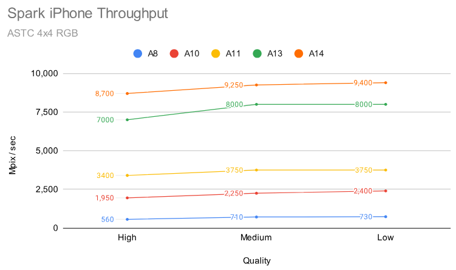

Оглавление:
* [Применение в играх](#Применение-в-играх)
* [Что можно улучшить](#Что-можно-улучшить)
* [Производительность](#Производительность)


# Виртуальные текстуры

Идея в том, чтобы хранить в памяти только те мипы текстуры, которые попадают на экран.

Во времена до bindless такой подход использовался чтобы забиндить одну текстуру для рисования всей сцены.
Сейчас только на старых мобилках и встройках Intel до Xe-LP+ не поддерживается массив из тысячи текстур.
И даже если bindless поддерживается, то в некоторых худших случаях его использование дает потерю производительности.
Подробнее это разобрано в статье про [Bindless](Bindless-ru.md).


## Алгоритм

Подробнее о вариациях алгоритма написано ниже в [Применение в играх](#Применение-в-играх), а здесь только основные моменты.

* Все текстуры складываются в одну виртуальную текстуру, которая нарезается на тайлы по 128х128 или 256х256 пикселей.
* Создается физическая текстура в которую подгружаются видимые тайлы.
* Создается такблица адресации в виде RG16U текстуры, которая конвертирует виртуальные UV в физические.
* Геометрии назначаются виртуальные UV.
* При проверке видимости моделей запрашивается загрузка тайлов текстуры.


## Процедурные текстуры

Кроме загружаемых текстур есть случаи, когда используется синтез текстур в рантайме.
Наример текстуры ландшафта получаются как комбинация из 2-4 затайленых текстур, а часто еще и с декалями поверх.
Это также позволяет делать детайлинг текстур, тогда как без синтеза дополнительные расчеты в фрагметном шейдере могут быть затратны, а также делают выборку текстур более случайной и могут сломать анизотропную фильтрацию.

Получаем зтраты на комбинирование 2-4 умноженое на количество PBR текстур.
Затраты на [детайлинг](#Detiling) умножаем еще на 2-4 в зависимости от алгоритма.
[Трипланарное текстурирование](#Triplanar-mapping) - умножаем все на 2-3.
Если поверх этого добавить еще рельефное текстурирование с трассировкой по текстуре глубины, то все это умножается на количество шагов.

В таком случае нагрузка на память увеличивается в разы, а детайлинг сильно нагрузит ALU, тогда для оптимизации кэшируют результат комбинации текстур и детайлинга в виртуальную текстуру.

Но тут возникает проблема - заранее подготовленные текстуры имеют сжатие ASTC или BC, а синтезированные - нет.
Таким образом вместо 4х чтений сжатой текстуры идет 1 чтение несжатой, что в 4-8 раз дороже.
Поэтому добавляют еще один этап со сжатием синтезированной текстуры обратно в ASTC/BC формат.


## Работа с памятью

OpenGL и DX11 не позволяли управлять памятью, поэтому все медленные аллокации происходили в главном потоке, виртуальные текстуры решают эту проблему.

В Vulkan и DX12 уже есть управление памятью и легко вынести тяжелые аллокации в другой поток, но возникает проблема с фрагментацией.
С текстурами одинакового размера написать алокатор легко - обычное выделение по фиксированным блокам, либо более продвинутое с захватом 2 и более блоков.
Но чаще бывают текстуры разных размеров в памяти, что требует более сложного аллокатора, либо проходов дефрагментации.
Виртуальные текстуры заменяют эту проблему на проблему кэширования тайлов в физической текстуре.

Виртуальные текстуры требуют подготавливать ресурсы - заранее нарезать текстуры на тайлы, а моделям задавать виртуальные UV.
Также можно подготовить и отдельные текстуры подогнав их под размеры фиксированного блока, что упростит работу аллокатору.
Тем более в bindless не так важно сколько текстур используется в модели.

Виртуальные текстуры держат в памяти только то, что реально используется, это значительно экономит память.
Bindless подход потребует загружать верхние мипы по необходимости. Без использования sparse memory это приведет к новому выделению памяти и копированию из старой текстуры в новую.


# Применение в играх

## Rage (idTech 5)

Вся геометрия использует виртуальные текстуры, в отличие от игр вышедших позднее, где виртуальные текстуры использовали только для ландшафта.

Размер виртуальной текстуры 128К х 128К.
Виртуальная текстура состоит из 1024х1024 страниц, где каждая страница это неделимая часть физической текстуры размером 128х128 (тайл).

Мип уровни также делятся на тайлы по 128х128 текселей.
Когда размер мипа становится менее 128, то для экономии места их можно объединить с другими текстурами, то есть сделать атлас внутри одного тайла.
Но чаще в таких случаях заменяют геометрию на более упрощенную и с отдельной текстурой.

**Проверка видимости**

Какие тайлы нужно загрузить на ГП решается отдельным проходом, где рисуется сцена и в feedback buffer записывается какие тайлы видны.
Далее буфер читается на ЦП, подгружает тайлы с диска и обновляет indirection map - небольшая текстура, которая конвертирует uv+mip виртуальной текстуры в uv текстуры в памяти ГП.

Скорее всего рисование идет в 2 прохода, сначала depth pre-pass, а затем уже заполнение feedback buffer, таким образом в запросы на стриминг попадают только видимые текстуры.

**Рисование**

В фрагментном шейдере получаем обычный UV, с помощью дериватив (dFdx) считается нужный мип-уровень, далее с помощью indirection map это конвертируется в UV физической текстуры.
Если мип-уровень еще не загружен, то в indirection map хранится ссылка на более мелкий мип-уровень.

Для трилинейной фильтрации текстура читается дважды с разным мип-уровнем, а затем интерполируется в шейдере.
Внутри ГП все происходит также, поэтому производительность не снижается.
Двойное чтение indirection map почти бесплатно, так как закэшируется для соседних пикселей.

Для анизотропной фильтрации 4х потребуется отступ в 4 пикселя между тайлами.
При конвертации виртуальных UV в физические используется только внутренняя область без отступа.
Далее анизотропная фильтрация эмулируется через множественное чтение текстуры, при этом indirection map читается только 2 раза для получения мипов.

Ссылки:
* [Siggraph2009: id Tech 5 Challenges](https://mrl.cs.vsb.cz/people/gaura/agu/05-JP_id_Tech_5_Challenges.pdf)


## Battlefield 3

Тайлы по 256х256 текселей.

Для выбранного уровня детализации требуется виртуальная текстура размером 1Мх1М, где indirection map будет 4Кх4К, что очень много.
Решили это через clipmap - 6 слоев по 64х64. Индекс clipmap выбирается на ЦП при вызове рисования, чтобы убрать эту логику из фрагментного шейдера.

Ссылки:
* [Terrain in Battlefield 3: A modern, complete and scalable system](https://media.contentapi.ea.com/content/dam/eacom/frostbite/files/gdc12-terrain-in-battlefield3.pdf) (слайды 30-40)


## Far Cry 4

Цель была получить разрешение в 10 текселей на сантиметр, для мира в 10х10 километров это виртуальная текстура размером 10Мх10М.

Вся карта 10х10км делится на сектора по 64х64 метра.<br/>
Для самых близких секторов используется виртуальная текстура 64Кх64К.<br/>
Для более дальних секторов размер виртуальной текстуры уменьшается: 32Кх32К, 16Кх16 и тд до 1Кх1К.<br/>
Тайлы по 256х256 текселей.

Когда камера приближается виртаульная текстура также увеличивается линейной интерполяцией, а затем генерируется заново, мипы только переназначаются в indirection map.
Аналогично, когда сектор становится дальше, то виртуальная текстура уменьшается, верхний мип удаляется, а остальные переназначаются.

Вместо отдельного прохода запись ID тайлов идет в GBuffer pass.

Поддерерживают 8х анизотропную фильтрацию, для этого добавляют отступ 4 текселя для каждого тайла, получается размер 264х264.

Ссылки:
* [Adaptive virtual texture rendering in 'Far Cry 4'](https://gdcvault.com/play/1021761/Adaptive-Virtual-Texture-Rendering-in), [video](https://gdcvault.com/play/1021760/Adaptive-Virtual-Texture-Rendering-in), [youtube](https://www.youtube.com/watch?v=SVPMhGteeuE)
* [Adaptive virtual terrain texturing](https://nebulatrifid.org/?p=1493)
* [Rendering the World of Far Cry 4](https://www.youtube.com/watch?v=rD6KcxcCl_8)


## Assassin's Creed Unity

Виртуальная текстура размером 256Кх256К.<br/>
Тайлы по 128х128 текселей.<br/>
Физическая текстура на ГП всего 8Кх8К.<br/>

Тут сделали хитрее - для повышения точности отсечения по [HiZ](GeometryCulling-ru.md#Hierarchy-Z-Buffer-HZB-HiZ) они нарезали геометрию на мешлеты ("кластеры" в презентации) по 64 вершины.
Мешлеты в сочетании с виртуальными текстурами позволяют отрисовать сцену за один вызов рисования.

Используется отложенное текстурирование, где физический UV (2x16 бит) записывается в G-буфер, для 8К текстуры это дает 8 значений (3 бита) субпиксельной точности.
Дистанция по UV проверяется, чтобы определить правильность деривативов, если неправильные, то включают билинейную фильтрацию, а мип уровень получается из номера страницы (*физический UV конвертируется в номер страницы*).
Также по номеру страницы получаются и ID материала.

Не используют отдельный проход для запроса физический страниц.

<details><summary>Размышления</summary>

В презентации ничего не сказано про сложность переноса обычных моделей на виртуальные текстуры, а проблема вот в чем:
размер тайла фиксирован, а каждый мип занимает в 4 раза меньшую площадь, поэтому чтобы уместить мип в тайл нужно добавить туда сразу 4 мипа.
Для мегатекстуры ландшафта легко получить мип размером с тайл, а как это сделать для модели?

У моделей есть уровни детализации, для соседних уровней могут быть одинаковые текстуры, а следовательно один диапазон виртуальных UV.
Для меньших уровней детализации будут уже другие текстуры с другими виртуальными UV и, возможно, не будет части эффектов типа имитации рельефа, тогда эта развертка объединяется с разверткой другой модели и получается полный тайл.

В худшем случае можно занять 1/4 тайла, но размер физической текстуры ограничен и в таком случае меньше места останется для детальных текстур.

Еще вариант - для наименьшей детализации задать цвет каждой вершине, остальное скроет туман, атмосферное размытие и тд.

Сказано только, что "не используют отдельный проход для запроса физический страниц", но нет деталей как это работает.
Можно предположить что запрос идет на этапе проверки видимости кластера, как это сделано в UE для запроса нижних мип уровней.
Либо запросы идут из фрагментного шейдера, но это утяжеляет его.

Насколько вообще оптимально хранить физические UV и делать расчеты в фрагментном шейдере?
За счет EarlyZ получается почти 1 фрагмент на пиксель, но добавляется quad overdraw, что для микротреугольников будет 4 фрагмента на пиксель.
Таблица конвертации виртуальных UV в физические попадает в кэш, так как кроме вершин ничего больше не используется и кэш достаточно пустой, это дает ускорение.
Если записать виртуальные UV, то они займут больше бит в G-буфере и все равно потребуется несколько бит на мип уровень, потому что на следующем проходе не все деривативы будут корректными.
С другой стороны виртуальные UV дадут корректные деривативы там, где физический UV попадает на стык между тайлами.

В презентации не сказано насколько удобно было художникам перейти на виртуальные текстуры. либо это все решалось на уровне тулзов.
То что этот подход не получил распространения в других движках показывает, что в этом могли быть трудности.

</details>

Ссылки:
* [Siggraph2015: GPU-Driven Rendering Pipelines](https://advances.realtimerendering.com/s2015/aaltonenhaar_siggraph2015_combined_final_footer_220dpi.pdf)


## Doom 2016

Ссылки:
* [THE DEVIL IS IN THE DETAILS](https://advances.realtimerendering.com/s2016/Siggraph2016_idTech6.pdf)


## Shadow of War

Здесь подход отличается, это не совсем виртуальные текстуры, скорее виртуальная память для обычных текстур.

Нижние мип-уровни грузятся сразу, а верхние только по необходимости, так как они занимают 66% памяти.
Для этого используется sparse memory - память верхнего мипа можно отвязать от текстуры и использовать для другой текстуры.

На этапе упаковки ресурсов для каждого меша ищется наибольший размер треугольника с наибольшей плотностью пикселей.
На этапе рисования этот треугольник проецируется на экран и рассчитывается примерный размер мип-уровня.
За кадр проверяется только 64 меша.

Ссылки:
* [GDC2018: Shadow of War: performance & memory optimization](https://www.gdcvault.com/play/1025429/Performance-and-Memory-Postmortem-for) (слайды 59-68)
* [The Sad State of Hardware Virtual Textures](https://hal.science/hal-05138369) - про производительность sparse memory.


## Ghost Recon Wildlands

Feedback pass оказался слишком затратным и его объединили с GBuffer pass: добавили RWTexture3D *(storage image3D в glsl)*.

Пример кода из презентации:

```
uint mip = ComputeVirtualTextureMipLevel(uvInPixel);
uint2 xy = floor(uvInPixel) * g_InvTileSize / float(1 << mip);
uint3 virtualAddress = uint3(xy, mip);
g_UsedTiles[virtualAddress] = VT_USED;  // imageStore() в glsl
```

Затем в компьют шейдере анализируют 3д текстуру и записывают ID незагруженых тайлов в feedback buffer.

Расход видеопамяти для 1080p экрана получился 218Мб, а для 4К уже 1Гб.

<details><summary>Размышления</summary>

Почему используется 3D текстура?
Для использования 2D текстуры с мипами потребуется массив текстур (storage image 2D), это требует динамической индексации, что не поддерживается в DX11/GL.

</details>

Ссылки:
* ['Ghost Recon Wildlands': Terrain Tools and Technology](https://gdcvault.com/play/1024708/-Ghost-Recon-Wildlands-Terrain) (слайды 55-64)


## Unreal Engine

В [UE](https://dev.epicgames.com/documentation/en-us/unreal-engine/streaming-virtual-texturing-in-unreal-engine?application_version=5.5) есть ограничения и особенности:
* Трилинейную фильтрацию делают стохастически - за один кадр читается только один мип-уровень, они чередуются каждый кадр и смешиваются.
* Анизотропная фильтрация зависит от отступа, обычно это 4 пикселя и 4х фильтрация.

В UE5 виртуальные текстуры совместимы с Nanite, что позволяет использовать их не только для ландшафтов.

Они также отказались от отдельного feedback прохода и комбинируют его с заполнением GBuffer, точнее resolve pass для [visibility buffer](GeometryCulling-ru.md#Visibility-Buffer-VisBuf), это дает наилучшую точность так как обрабатывается единственный видимый фрагмент на пиксель.
Результат упаковывается в неиспользуемые каналы GBuffer-а, например альфа канал velocity buffer.
Дополнительно текстуры в низком разрешении запрашиваются после HiZ теста.

Также в UE виртуальными могут быть texture array и 3D текстуры.

Для повышения точности в BC3 формате хранят цвет в YCoCg пространстве вместо обычного RGBA, альфа канал с высокой точностью (BC4 формат) хранит Y компоенту.


# Что можно улучшить

## Parallax Mapping

Для имитации рельефа используется трассировка по карте глубины и смещение UV.
Как только UV смещается за пределы тайла виртуальной текстуры возникают проблемы, поэтому приходится обращаться к indirection map на каждом шаге трассировки.
Это не так плохо пока результат закэширован (в L1), но на границе между тайлами начинается вырождение потоков: часть потоков делают трассировку по одному тайлу, а часть по другому, из-за чего UV физической текстуры различаются и неявные деривативы работают некорректно.

Для оптимизации можно делать трассировку по меньшему мип-уровню, тогда будет меньше переключений между тайлами.

Еще одна проблема возникает, когда при трассировке нужно перейти на следующий тайл, а он не загружен в память.
В этом случае придется останавливать маршинг или использовать нижний мип-уровень.


## HW Trilinear filtering

Большинтсво используют 2 чтения и интерполяцию в шейдере, но есть другой способ - добавить мип уровень в виртуальную текстуру, это займет всего 1/4 памяти физической текстуры, зато меньше изменений в фрагментном шейдере.
Минус такого подхода - для трилинейной фильтрации без чтения соседних тайлов нужен отступ в 3 текселя.
Еще один недостаток - загрязнение кэша, так как одна и тот же мип уровень оригинальной текстуры может быть и в мип 1 и в мип 0 виртуальной текстуры.

Также не придется эмулировать анизотропную фильтрацию, но отступ потребуется еще больше.
Проблема решается, если ограничить максимальную разницу между деривативами возле границы между тайлами.

Таблица с минимальным отступом для корректной фильтрации

| filter         | 1 mip | 2 mips |
|----------------|-------|--------|
| bilinear       | 1     | 1      |
| trilinear      | 1     | 3      |
| anisotropy 2x  | 1     | 4      |
| anisotropy 4x  | 2     | 6      |
| anisotropy 8x  | 4     | 10     |
| anisotropy 16x | 8     | 18     |

[Пример](https://github.com/azhirnov/AsEn-ShaderEditor/blob/main/src/scripts/virtual-tex/test-AnisotropyFilter-2.as) с замером области сэмплирования.

В таблице [Расход памяти](#Расход-памяти) видно, что наилучший вариант это отступ 4 для 128х128, что совместимо с анизотропной фильтрацией 2х с двумя мип уровнями, либо отступ 8 для тайла 256х256, что с некоторыми ограничениями хватит для фильтрации 8х.
Один из вариантов ограничения мип уровней, это использовать [Texture2DArray](#Texture2DArray).

Двух мип уровней не всегда достаточно - при большом угле нужно переключаться на меньший мип уровень, что в любом случае потребует хранить всю цепочку мипов или хотя бы 3-5 уровней.
Получается ради небольшого упрощения шейдера нужно усложнить сам алгоритм виртуальных текстур.
Но только таким образом можно получить одинаковый результат фильтрации, если сравнивать виртуальную текстуру и мега текстуру со всеми мипами, как это сделано в примерах:
[Basic v3](https://github.com/azhirnov/AsEn-ShaderEditor/blob/main/src/scripts/virtual-tex/Basic-3.as),
[Basic v4](https://github.com/azhirnov/AsEn-ShaderEditor/blob/main/src/scripts/virtual-tex/Basic-4.as).


## Texture prefetch

Если фрагментный шейдер читает текстуру без изменений `uv`, то этот тексель читается еще до запуска вапра, что уменьшает количество активных варпов.
Если `uv` меняется, как это происходит при конвертации из виртуальных координат в физические, то варп сначала запускается, читает из indirection map (возможен префетч), пока идет чтение этот варп ставится на паузу и начинает выполняться другой, далее просыпается и читает физическую текстуру, опять ставится на паузу и ждет более долгое чтение.

Чем медленее чтение, например из LPDDR памяти, тем больше варпов должно поместиться в один CU, а для этого должно хватить размера регистрового файла.
На слабом железе это важная оптимизация.

Логичный вариант - рассчитать физический `uv` еще в вершинном шейдере, но если в треугольник попадут вершины с разными тайлами, то интерполированные `uv` окажутся неправильными.
В варианте с мешлетами можно гарантировать, что `uv` в пределах треугольника всегда соответствуют одному тайлу.
То же самое можно сделать на меш шейдере, но уже автоматически тесселировать треугольник попадающий между тайлами.
Другой вариант - пройтись по всей геометрии и обновить `uv` на физический, на мощном железе это должно быть дешево.

В пределах одного треугольника могут потребоваться разные мип уровни, поэтому конвертация `uv` не сработает без наличия мип уровней в физической текстуре, как это описано в [HW Trilinear filtering](#HW-Trilinear-filtering).

Не применимо для параллакса, так как трассировка по текстуре глубины может выйти за пределы тайла, которые в данном случае неизвестны.
Но вариант с одним шагом трассировки должен работать.


## Sparse Memory

Sparse memory позволяет привязывать физическую память размером 64КБ к текстурам, вместо того чтобы выделять память под всю текстуру.
Таким образом убирается indirection map, теперь физические тайлы цепляются к виртуальной текстуре.

Преимущества:
* Больше не нужны отступы для правильной фильтрации между тайлами, что экономит память и эффективнее использует кэш.

Недостатки:
* Размер в 64КБ не всегда удобен - тайл 128х128 с BC7 сжатием занимает 16КБ, а следующий мип уровень уже 4КБ.
В Metal этот размер не фиксирован и зависит от размера и формата текстуры, что еще усложняет такой подход.
* Максимальный размер текстур не позволяет использовать слишком большие виртуальные текстуры, остается вариант с texture array.
* vkBindSparse может быть очень медленным (100мс на 1000 тайлов и до 100 раз медленее софтварного варианта, как сказано в "[The Sad State of Hardware Virtual Textures](https://hal.science/hal-05138369)").
* Анизотропная фильтрация ограничена 4х на AMD и не поддерживается на Intel.
* Не поддерживается на многих мобилках, кроме свежих Adreno и некоторых PowerVR.


## Texture2DArray

Чтобы избавиться от отступов в 4 пикселя по краям тайла есть возможность создать текстурный массив, где каждый тайл 128х128 это отдельный слой.
Это позволит включать анизотропную фильтрацию до 16х с меньшими отступами, но ценой ухудшения качества фильтрации на стыках тайлов.

Недостаток такого способа - ограниченное количество тайлов, обычно доступно 1024 или 2048 слоев.
1024 слоя соответствуют 32x32 тайлам, так для тайла 128х128 получаем 2D текстуру 4Кх4К, что очень мало.
В некоторых случаях 3D текстура позволяет выделить больше слоев в глубину, например до 16384 на NV и Mali, 8192 на AMD и 2048 на остальных.
Для 16384 слоев 3D текстуры получаем 128х128 тайлов, а это аналогично 16Кх16К 2D текстуре при размере тайла 128х128.


## Эмуляция Bindless

Bindless подход не решает проблему подгрузки мипов, при которой нужно заново выделять память текстуры, виртуальные текстуры изначально решают эту проблему.
Но есть что-то среднее - сделать массив из разных Texture2DArray, где каждая будет иметь разный размер и формат.
Получается 4D индексация: индекс текстуры, номер слоя в текстуре и UV.

Дополнительно нужно ограничить чтение верхних мипов через `textureLod`, пока они не загрузились.

Это решает проблему ограниченного количества текстур для bindless: 128-256 на старых Intel и мобилках.

В некоторых случаях можно обойтись без динамической индексации и отсортировать геометрию по используемым Texture2DArray, тогда будет работать даже на OpenGL.


## Запросы на загрузку

Алгоритм целиком:

* В G-буфер проходе расчитывается верхний мип, конвертируется в номер страницы, этот результат пишется в канал G-буфера.
Далее проверяется есть ли страница в памяти, если нет, то понижается мип, но в G-буфер пишется именно первый рассчитаный мип.
* Читаются номера страниц из G-буфера, убираются дубликаты, для каждой уникальной страницы выставляется номер текущего кадра.
Если страница не загружена в память и попадает на экран, то добавляется в очередь загрузки.
* Идет проход по части indirection map.
Если страница загружена, но давно не используется, то постепенно выгружается начиная с верхних мипов.
Так обход всей indirection map растянут на несколько кадров.
* На ЦП обрабатывается очередь и тайлы подгружаются с диска, а ненужные удаляются.


Из обзора презентаций видно несколько вариантов заполнения очереди на загрузку:

### Отдельный проход

Отдельный проход в меньшем разрешении, где записывается номер страницы.

Преимущества:
* Хорошо для старых мобилок с низкой детализированой геометрией.
* Более компактный вывод, значит меньше нагрузка на память при анализе.

Недостатки:
* Большая цена за рисование геометрии, особено с микротреугольниками.


### Обновление 3D storage image

Запросы в G-буфер проходе пишутся в 3D текстуру, затем анализируются в отдельном проходе. Атомарные операции здесь не нужны, но нагрузка на память увеличивается.

Преимущества:
* Не требует атомарных операций, так как все потоки пишут одинаковое значение - номер кадра. Это дает выигрышь в производительности.
* Для оптимизации по памяти можно заменить на битовые поля и обновлять их атомарными операциями. Без чтения результата атомика это достаточно быстро на ПК, но могут быть большие потери на мобилках.
* Для 4К можно обновлять один пиксель на квадрат 8х8 и более, что значительно снизит нагрузку на память.
Для VR с гарантированными 90 кадров в секунду это не приведет к замедлению загрузки.
* Работает и с прозрачной геометрией.

Недостатки:
* Каждый пиксель экрана пишет в 3D текстуру 2Кх2К и более, это большая нагрузка на память.
Можно снизить нагрузку, если только 1 поток из квадарата 2х2 пишет номер кадра, так как деривативы у них совпадают, но это плохо работает с однопиксельными треугольниками.
Поэтому обязательно чередовать пишущий поток в пределах квадрата, так как он может попасть на вспомогательный поток, который ничего не запишет.
* Требует отдельный проход по всей 3D текстуре, чтобы сформировать запросы, это большая нагрузка на память.
И тут можно растянуть по кадрам, но это точно приведет к увеличению времени подгрузки текстур.


### Свободный канал G-буфера

Запросы в G-буфер проходе пишутся в свободный канал, затем анализируются в отдельном проходе.

Преимущества:
* Используется аппаратное сжатие, что немного ускоряет запись и чтение, но требует более градиентные значения для лучшего сжатия.
* Требует отдельный проход для устранения дубликатов и обновления номера кадра в indirection map.
Для ландшафта будет много дубликатов, что снизит нагрузку на память, но для моделей с виртуальными текстурами разнообразие будет намного больше.

Недостатки:
* Тут пишется один канал, а при обработке читается вся текстура, что увеличивает нагрузку на память.
Отдельная текстура может быть эффективнее, если не упрется в аппаратную часть - количество записаных пикселей на текстуру на размер экрана.
* Не работает для прозрачной геометрии:
	- Еще один канал в проходе с польшим наложением пикселей (overdraw) снижает производительность.
	- Сохраняется только последнее значение, а нужны все.
* Для 4К больше расход памяти.

Оптимизация:
* Если используется отдельная текстура, то можно обновлять ее большими квадратами 4х4 - 16х16.
Пустой квадрат пишут нули, тогда после сжатия передается только несколько байт мета данных, что значительно снижает нагрузку на память.


### G-буфер в меньшем разрешении

Запросы в G-буфер проходе пишутся в 2D storage image в меньшем разрешении, так как нельзя просто понизить разрешение одного рендер таргета.

Преимущества:
* На AMD RDNA будет работать аппаратное сжатие. В отличие от 3D текстуры, тут запись позволяет хранить блоки 4х4 в кэше и затем сжимать их при записи в VRAM.
* Те же преимущества для 4К.
* Каждый поток пишет свой тексель, поэтому никакой конкуренции при записи, как в варианте с 3D текстурой.
* Также требует отдельный проход с анализом и устранением дубликатов.

Недостатки:
* Медленная запись на совсем старых мобилках.
* Чуть больше задержки на загрузку, так как не все запросы записываются.


### Мешлеты

Запрашивать на этапе проверки видимости мешлетов.

Преимущества:
* Можно запечь диапазон UV для запросов мипов в меньшей детализации.
* Лучше для 4К, при этом меньше задержка на загрузку.

Недостатки:
* Хуже попиксельная точность, так как треугольники мешлета могут быть наклонены к камере и потребуются не самые детальные текстуры.
* Для точного расчета детализации требуется обойти все треугольники, спроецировать их на экран, найти ближайший пиксель и рассчитать для него деривативы.
Если используются микротреугольники, то достаточно расчитать деривативы для центра треугольника.
Этот этап можно объединить с отсечением по треугольникам, но такой вариант устарел.


Для 4К экрана и тем более мобильного VR, запись в 3D storage image из G-буфер прохода становятся дороже.
Отдельный проход уже давно не актуален из-за высокой детализации геометрии.
Остаются варианты с записью в G-буфер и с запросом для мешлета.

**Запись в G-буфер**


Но кроме запросов на подгрузку страниц нужно еще и выгружать ненужные страницы, для этого требуется помечать все страницы, которые используются в кадре.
По этой причине рисовать квадратами может быть неоптимально, так как это увеличит задержку на выгрузку страницы.

Также остается проблема с прозрачной геометрией, которая не пишет в G-буфер. Тут лучше подходит вариант когда запрос идет сразу из фрагментного шейдера, либо через мешлеты.


## Не квадратные страницы

Актуально при использовании виртуальных текстур для зданий.
Развертка всех моделей добавляется в большой атлас - виртуальную текстуру, это позволяет генерировать уникальную текстуру для каждого здания запекая туда декали.

Здания часто имеют более вытянутую форму, вблизи они еще режутся на квадратные тайлы, но вдали получается, что здание делится например на 2 тайла в ширину и использует только половину тайла в высоту.
Здание поближе будет 4х2 тайла по 128х128 или 2х1 тайл 256х256 или 2х2 тайла 256х128. При рисовании города часто видна только верхняя часть дальних домов, в таком случае тайлы 128х128 и 256х128 экономит физическую память в 2 раза.
В bindless подходе такая оптимизация невозможна и весь атлас здания будет загружен в память, оптимизируются только верхние мипы.

Для атласов в целом это позволит сделать пустую линию в 128 текселей, чтобы мип уровни одного аталаса не пересекались с мипами другого.
Для тайлов 128х128 размер виртуальной текстуры маловат, для тайлов 256х256 много места не используется, а вот тайлы 256х128 на половину уменьшают виртуальную текстуру, но и уменьшает пустые места.

Как это реализовать:
* Всегда использовать страницы 2:1, но это чуть хуже для ландшафтов. Тут можно добавить бит к запросу страницы, чтобы грузить сразу квадратный тайл ландшафта.
* Сделать две физические текстуры, где одна для ландшатфа, другая для геометрии. Это не оптимально по памяти, так как ландшафт есть не всегда.


## Расход памяти

Чем больше отступ внутри тайла, тем больше памяти тратится впустую - дублируются тексели в разных тайлах.
Отступ считается внутрь тайла, то есть 128х128 с отступом 4 получается 120х120.

Из таблицы видно, что для тайла 128x128 отступ 4 дает потерю в 12%, аналогично для тайла 256x256 отступ 8 дает те же 12%.

| border (px) | tile dim (px) | visible texels / total (%) |
|-------------|---------------|----------------------------|
| 1 | 128x128 | 97 |
| 2 | 128x128 | 94 |
| 4 | 128x128 | 88 |
| 8 | 128x128 | 77 |
| 16 | 128x128 | 56 |
| 1 | 256x128 | 98 |
| 2 | 256x128 | 95 |
| 4 | 256x128 | 91 |
| 8 | 256x128 | 82 |
| 16 | 256x128 | 66 |
| 1 | 256x256 | 98 |
| 2 | 256x256 | 97 |
| 4 | 256x256 | 94 |
| 8 | 256x256 | 88 |
| 16 | 256x256 | 77 |

Для сжатых форматов отступ должен быть кратен 4, что совпадает с размером блока 4х4.
В определенных случаях и отступ 2 можно приспособить, так как с обеих сторон это дает суммарный отступ 4, для этого виртуальные UV должны начинаться с координаты (2,2).

Если все текстуры генерируются на ГП, а не грузятся с диска, то размер отступа может быть любым.

Есть вариант масштабировать размер тайла под разрешение экрана. Так переход на 4К приведет к увеличению количества тайлов 128х128, а если для 1080p использовать тайлы 128х128, а для 4К - 256х256, то количество тайлов останется примерно таким же.
Использование апскейлера немного меняет ситуацию и вместо 4К получим что-то вроде 2К-2.5К.


## Таблица страниц

Обычно используются названия indirection map или page table.

Встречается несколько вариантов:
* 2D текстура с мипами.
	- Подходит для одной виртуальной текстуры, как в [Rage](#Rage-idTech-5).
	- Для больших миров размер текстуры слишком большой - 4Кх4К и более, что дорого обрабатывать и занимает много памяти.
* 3D текстура.
	- Аналогично 2D текстуре, решает проблему динамической индексации мипов на старых GAPI при записи в storage image.
	- Занимает больше памяти, но это не влияет на трафик памяти каждый кадр, так как нет чтения/записи.
* 2D clipmap (2D texture array) как в [Battlefield 3](#Battlefield-3).
	- Уменьшает расход памяти, так как дальние тайлы никогда не будут в высоком разрешении.
	- Хуже подходит для отдельной геометрии и вокселей (3D ландшафта), так как виртуальные UV плохо соотносятся с положением объектов в пространстве, как это происходит для 2D ландшафта.
* sparse memory.
	- Это экономит память и лучше работает со случайными виртуальными UV.
	- Привязка страниц памяти происходит не так часто, как для страниц основных текстур, поэтому не должно быть проблем с производительностью.
* Динамические виртуальные UV.
	- Это как таблица адресации для таблицы адресации, только вместо двойного чтения в шейдере идет обновление UV в геометрии.
	- Изначально геометрия содержит UV в своем атласе и только при загрузке на ГП ей назначаются виртуальные UV, так виртуальные UV остаются компактными.
	- Каждый атлас может быть нарезан на тайлы например по 2Кх2К, тогда размещение их в виртуальной текстуре будет простым алгоритмом в отличие от более сложных динамических атласов с разным размером текстур.
	- В [Far Cry 4](#Far-Cry-4) для ландшафта используют виртуальные текстуры разных размеров начиная с 64Кх64К, далее 32К, 16К и тд. Если сделать виртуальную текстуру 256К, то четверть резервируется под текстуру ландшафта на 64К, а остальное остается под атласы для моделей.
* 2D текстура с мипами, но отдельно для каждой геометрии.
	- Скорее всего требует bindless чтобы отрисовать все за один проход как в AC: Unity.
	- Другой вариант - собрать мини-текстуры в атлас. Тут даже отступы не нужны, так как не используется фильтрация.


# Производительность

## Detiling

Все алгоритмы предполагают дополнительные расчеты для трансформации UV, что нагружает ALU и повышает нагрузку на кэш из-за более случайного чтения.
Больше чтений текстур также сильнее нагружает кэш и VRAM в случае промаха.

Так как все расчеты идут при синтезе текстуры, то это влияет только на скорость обновления, так как меньше тайлов будет обработано за кадр, чтобы попасть в бюджет на обновление.

Ссылки:
* [texture repetition - 2015](https://iquilezles.org/articles/texturerepetition/)
* [hextile-demo](https://github.com/mmikk/hextile-demo), [Practical Real-Time Hex-Tiling](https://jcgt.org/published/0011/03/05/)

Исходники:
* [Detiling](https://github.com/azhirnov/AsEn-ShaderEditor/blob/main/src/scripts/tex-mix/Detiling.as)


## Сжатие на ГП

### Реализация в железе

В современных ГП есть встроенный механизм сжатия рендер таргетов, он используется чтобы снизить нагрузку на память при рисовании в текстуру, что одна из нагруженых по памяти операций.
Сделано это через delta color compression (DCC) - для блока 4х4 передается один базовый цвет и смещения от него.
При использовании текстуры как storage image происходит декомпрессия, что долго (несколько миллисекунд), это один из признаков как можно понять, что ГП использует сжатие для этой текстуры.

Замеры степени сжатия можно посмотреть в [результатах тестов](https://github.com/azhirnov/AsEn-ShaderEditor/blob/main/papers/GPU_Benchmarks.md#Render-target-compression).
В тесте проверяется скорость чтения сжатой текстуры, а не запись со сжатием. Для пиксельного шума включенный DCC дает менее 10% ускорения, по счетчикам получается до 30% уменьшение траффика на некоторых ГП или на 10% замедление из-за добавления метаданных в трафик.
Ускорение начинается с записи градиаентов в цвет, тогда скорость чтения увеличивается в 3 раза, что близко к BC сжатию.
Сжатие без потерь будет хорошей заменой BC7 сжатию, програмная реализация которого работает очень медленно.
Но и тут есть нюанс - на NV текстура 8Кх8К уже не поддерживает сжатие и это одинаково для 8Гб и 16Гб версий.

В свежих мобилках появилось сжатие с потерями, что еще сильнее снижает нагрузку на память.
Подробное сравнения с BC/ASTC сжатием есть в статье [Hardware Image Compression](https://www.ludicon.com/castano/blog/2026/03/hardware-image-compression/).

<details><summary>Сжатие с потерями поддерживается начиная с:</summary>

* Adreno 800
* ARM Mali Valhall gen3
* Apple M2, A15
* AMD RDNA2 RADV драйвер (эмуляция?)
* PowerVR Series-8 (vk 1.3 драйвер)

</details>

Главное преимущество использования аппаратного сжатия - не нужно делать програмное сжатие, что требует больших затрат на разработку.

Также из преимуществ: BC1-BC5 сжатие дает разные значения на разных ГП. Так на NV расхождение доходит до 2% по сравнению со стандартным декодером, на 8 битном цвете это уже заметное расхождение в 5/255.
BC6-BC7 сжатие исправляет это расхождение, но и более затратное для кодирования.


### Програмное сжатие

На сайте [Spark](https://ludicon.com/spark/tech.html#performance) есть замеры производительности на iPhone. На высоком качестве получается от 560Mpix/s на A8 до 8.7Gpix/s на A14 для ASTC4x4.
Переводя это в тайлы 256x256, получаем от 120 мкс до 8мкс на тайл, что дешево даже для мобилок.



В докладе ['Delta Force': Performant High-Quality Terrain and Biome Technology for PC and Mobile (слайд 63)](https://gdcvault.com/play/1035606/-Delta-Force-Performant-High) расказывают как использовали ASTC 4x4 и 6x6 для сжатия.
Размер блока 6х6 потребует другой размер тайла - 192 или 384, вместо 128 или 256.

В рекомендациях по оптимизации говорят ASTC распаковывается в L1, тогда как ETC2 хранится сжатым в L1.
Это позволяет экономить L1, платя за это чуть худшим качеством сжатия.

Есть вариант быстрого сжатия в YCbCr 4:2:2, для него есть аппаратная поддержка сэмплирования, а занимает всего 16 бит на тексель, что в 2 раза меньше RGBA8 (RGB8 на ПК обычно не поддерживается, в отличие от мобилок).
Опять же в L1 будет храниться меньше данных, чем при ASTC сжатии.
Но чтение мультипланарного формата дороже, чаще всего это один сэмпл на слой, то есть минимум в 2 раза больше чтений, а может быть и в 3.


### Нейросжатие

Идея в том, чтобы вместо множества PBR текстур хранить только одну сжатую, а остальные получать через распаковку используя тензорные ядра.
Предлагается 2 варианта:
* Загружать на ГП сжатую текстуру и там распаковывать в виртуальную текстуру с BC-сжатием. Это значительно увеличивает пропускную способность PCI-E и скорость чтения с диска.
* Хранить нейро-сжатые текстуры на ГП. На каждое чтение потребуется тяжелая распаковка, для фильтрации цена умножается на количество сэмплов, что очень дорого, поэтому добавляют стохастическую фильтрацию, когда каждый кадр читается только один тексель, а фильтрация получается за счет складывания нескольких кадров.

Ссылки:
* [RTXNTC](https://github.com/NVIDIA-RTX/RTXNTC).


## Задержки на загрузку

Обновление одной страницы выглядит так:
* На ЦП читаем запрос на загрузку. Тут задержка в 1-3 кадра, при 60fps это 16мс - 50мс.
На ПК обычно 1 кадр, на мобилках до 3.
* Загружаем тайл с диска. Обычно это 5 PBR тайлов 128х128 или 256х256, что 16-64 КБ на тайл BC7/ASTC или в 2 раза меньше для BC1/ETC2, на 5 тайлов это 80-320 КБ.
Для старых HDD с 100Мб/с это 0.8-3.1мс, плюс задержка на позиционирование до 20мс, а в худшем случае если диск спит, то до 2с.
ОС может кэшировать запросы к диску, тогда скорость увеличивается до 20-60Гб/с в зависимости от скорости RAM.
Для новых SSD с 5ГБ/с это 15-61мкс, а задержка не более 20-100мкс.
* Обычно тайлы хранят сжатыми, поэтому загрузка с диска будет в разы быстрее, но добавится распаковка на скорости около 10Гб/с (сильно зависит от железа и сжатия), получаем 8-30мкс.
* Загружаем тайл на ГП, тут упираемся в скорость PCI-E, при 16Гб/с получаем 4-16мкс.
Более актуально для кэша тайлов в RAM, так как чтение с диска очень медленное.


Если добавить синтез текстур, то все сложнее:
* На ЦП читаем запрос на загрузку.
* Загружаем тайл с диска.
Обычно это маски для синтеза, они в меньшем разрешении и с большей вероятностью закэшированы в RAM, так что бесплатно.
Но есть тайлящиеся текстуры из которых идет синтез, детальные текстуры могут быть 8Кх8К, что очень много, поэтому будет подгружаться из RAM или диска.
Для загрузки тайлящихся текстур с диска получаем в 2-4 раза большую нагрузку, но больше вероятность попасть в кэши.
* Загружаем декали с диска. В большинстве случаев их не так много, так что они уже закэшированы на ГП.
Но если декалей много и они в очень высоком разрешении, то придется подгружать либо весь атлас, что дорого и не оптимально, либо небольшие текстуры и собирать их в динамический атлас.
* Загружаем маски и декали на ГП. Опять же скорее всего они уже там, либо это быстро.
* Запускаем синтез на ГП. Тут сильно зависит от производительности ГП:
	- Из тайлящихся текстур ландшафта, масок и декалей синтезируются итоговые PBR тайлы, обычно упирается в чтение текстур, что на слабых мобилках 20Гб/с, на ПК - 1ТБ/с и более, быстрых мобилок это около 60-80Гб/с.
Мы читаем до 4 тайлящихся текстур, они могут быть до 8Кх8К, но читается один тексель, так что реальный размер совпадает с размером тайла.
Дополнительно читаются маски в меньшем разрешении, декали и тд, примерно как один размер тайла.
В сумме 5 PBR текстур по 5 материалов на тайл 256х256 с сжатием BC7 (4х сжатие), это 64КБ х5 х5, что 1.6МБ, при 60Гб/с получаем 24мкс.
	- Затем происходит сжатие в BC/ETC/ASTC формат, примерно 8мкс на тайл 256х256 для быстрых мобилок. Но PBR текстур может быть 5, поэтому 40мкс.
	- Все упирается в лимиты на кадра, для 60fps это 1-2мс, для VR и 120fps скорее 0.5мс.
	При размере физической текстуры в 8Кх8К получаем 64х64 тайла 128х128 или 32х32 тайла 256х256.
	У нас 24мкс на синтез и 40мкс на сжатие тайла, 1024 тайлов на физическую текстуру, это 64мкс на тайл и 65мс на всю физическую текстуру.
	С лимитом 1мс это 65 кадров на полное обновление, что достаточно быстро.


## Насколько применимо для мобилок

Доступ к RAM обычно медленный и расходует много энергии, по этой причине излишнее копирование текстур дорогое, сжатие в рантайме тоже.

Совсем слабое железо используют:
* Обычные тайлящиеся текстуры для ландшафтов, так текстуры полностью помещаются в L2 и дорогая VRAM не дергается.
	- паттерн маскируется деталями на карте (кусты, деревья).
	- стыки биомов более редкие и маскируются блендингом.
* Модели с градиентными текстурами, где один тексель на десятки видимых пикселей.

С такими оптимизациями переход на виртуальное текстурирование не требуется и только все замедлит.
Важно, что это дает ускорение на старом железе с векторной архитектурой и малым количеством регистров (4-8).
Любые дополнительные расчеты и отключение текстурного префетча дает огромное замедление.

Начиная с Mali Valhall архитектуры, Adreno 500, PowerVR B-Series производительность сильно увеличилась, количество регистров выросло в разы, что позволяет делать более сложное текстурирование.
В этом случае переход на виртуальные текстуры или bindless даст улучшение графики.

Важно смотреть во что упирается производительность.
Старый подход на более новом железе будет упираться в количество обрабатываемых пикселей, так как с ростом производительности увеличились и размеры экранов и плотность пикселей.
При этом сами ядра будут недостаточно нагружены, что позволяет улучшить графику без потери общей производительность, хоть и увеличит расход батареи.


# Ссылки

* [How Virtual Textures Really Work](https://www.shlom.dev/articles/how-virtual-textures-really-work/), [source](https://github.com/shlomnissan/virtual-textures)
* [The Sad State of Hardware Virtual Textures](https://hal.science/hal-05138369)
* UE:
	- [Virtualize Everything: Polygons, Shadows, and Textures, Oh My!](https://youtu.be/inGlMVhYB1s)

* Tech Art:
	- [From Battlegrounds to Fairways: Terrain Procedural Tools in Frostbite](https://youtu.be/tBXzyoK4GvE)
	- [Ghost Recon Wildlands Terrain Tools and Technology](https://www.youtube.com/watch?v=kzthHcbG9IM)
	- [Procedural World Generation of 'Far Cry 5'](https://www.gdcvault.com/play/1025557/Procedural-World-Generation-of-Far)
	- [Rendering the World of Far Cry 4](https://www.youtube.com/watch?v=rD6KcxcCl_8)
	- [Bringing the World to Your Shaders](https://media.gdcvault.com/GDC+2022/Speaker+Slides/BringingTheWorld_Oztalay_Matt.pdf)
	- [Landscape Material Blending With Runtime Virtual Textures - Building Worlds In Unreal - Episode 23](https://www.youtube.com/watch?v=5VVi9JvEGzM)
	- [Virtual Texturing, Live from HQ, Inside Unreal](https://www.youtube.com/watch?v=fhoZ2qMAfa4)
	- [Runtime Virtual Textures: The Ultimate Starter Guide (UE5)](https://youtu.be/RLEPA16QDRw)
	- [Runtime Virtual Textures: Medieval Game Environment extended tutorial](https://youtu.be/rSYEBIflhLU)

# Исходники

* [Basic v1](https://github.com/azhirnov/AsEn-ShaderEditor/blob/main/src/scripts/virtual-tex/Basic-1.as) - самая простая реализация, билинейная фильтрация.
* [Basic v2](https://github.com/azhirnov/AsEn-ShaderEditor/blob/main/src/scripts/virtual-tex/Basic-2.as) - трилинейная фильтрация, 2 мип уровня.
* [Basic v3](https://github.com/azhirnov/AsEn-ShaderEditor/blob/main/src/scripts/virtual-tex/Basic-3.as) - анизотропная фильтрация, 2 мип уровня.
* [Basic v4](https://github.com/azhirnov/AsEn-ShaderEditor/blob/main/src/scripts/virtual-tex/Basic-4.as) - анизотропная фильтрация, 1 мип уровень физической текстуры.
* - софтварная анизотропная фильтрация.
* [Anisotropy Filter](https://github.com/azhirnov/AsEn-ShaderEditor/blob/main/src/scripts/virtual-tex/test-AnisotropyFilter-2.as) - замер области сэмплирования.
* [Detiling](https://github.com/azhirnov/AsEn-ShaderEditor/blob/main/src/scripts/tex-mix/Detiling.as) - скрытие паттерна тайлинга.
* [Page Allocation](https://github.com/azhirnov/AsEn-ShaderEditor/blob/main/src/scripts/virtual-tex/test-PageAlloc-1.as) - демонстрация выделения страницы памяти под виртуальную текстуру.
* Декодирование блочных форматов:
	- [EAC](https://github.com/azhirnov/AsEn-ShaderEditor/blob/main/src/scripts/tools/compression/EACDecode.as)
	- [ETC2](https://github.com/azhirnov/AsEn-ShaderEditor/blob/main/src/scripts/tools/compression/ETC2Decode.as), [ETC2A1](https://github.com/azhirnov/AsEn-ShaderEditor/blob/main/src/scripts/tools/compression/ETC2A1Decode.as), [ETC2A8](https://github.com/azhirnov/AsEn-ShaderEditor/blob/main/src/scripts/tools/compression/ETC2A8Decode.as)
	- [BC1](https://github.com/azhirnov/AsEn-ShaderEditor/blob/main/src/scripts/tools/compression/BC1Decode.as)
	- [BC4](https://github.com/azhirnov/AsEn-ShaderEditor/blob/main/src/scripts/tools/compression/BC4Decode.as), [BC5](https://github.com/azhirnov/AsEn-ShaderEditor/blob/main/src/scripts/tools/compression/BC5Decode.as)
	- [BC6](https://github.com/azhirnov/AsEn-ShaderEditor/blob/main/src/scripts/tools/compression/BC6Decode.as), [BC7](https://github.com/azhirnov/AsEn-ShaderEditor/blob/main/src/scripts/tools/compression/BC7Decode.as)
